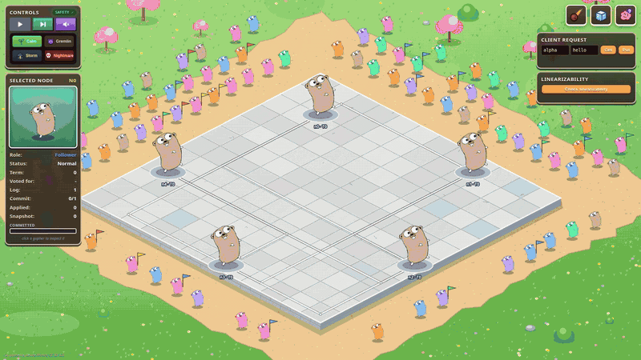

# kvraft

A Raft-replicated key/value store in Go, plus **Raft Under Fire**, a browser
game where you attack the real Raft code and watch it heal itself.

**Play it: [raftsim.kassab.dpdns.org](https://raftsim.kassab.dpdns.org)**

[](docs/raft-under-fire.mp4)

## What's inside

- **Raft**: leader election, log replication, snapshots, persistence.
- **KV store**: versioned Get/Put and transactions, over real TCP, served by an HTTP gateway.
- **Sharded mode**: shards move between replica groups, and cross-shard transactions use two-phase commit (2PC).
- **Raft Under Fire**: the same Raft code compiled to WebAssembly. Drop meteors, freeze nodes, wipe disks, switch on chaos modes, then check linearizability.

## Run it

```bash
docker compose up --build                                  # 5 nodes + gateway on :18080
curl -X PUT localhost:18080/kv/foo -d '{"value":"bar","version":0}'
curl localhost:18080/kv/foo
```

Sharded mode: `docker compose -f docker-compose.shard.yml up --build`, with its gateway on `:18081`.

Run the simulator locally. `make viz` compiles the Go code to WebAssembly and bundles the site into `viz/dist`, which you can serve with any static server:

```bash
make viz
npx serve viz/dist        # open http://localhost:3000
```

## Credits

- [TigerBeetle's simulator](https://sim.tigerbeetle.com), the inspiration for Raft Under Fire.
- The Go gopher by Renée French, licensed under CC BY 4.0.
- [MIT 6.5840](https://pdos.csail.mit.edu/6.824/) labs, where the Raft and shardkv code started.
- [Porcupine](https://github.com/anishathalye/porcupine) for linearizability checking.
